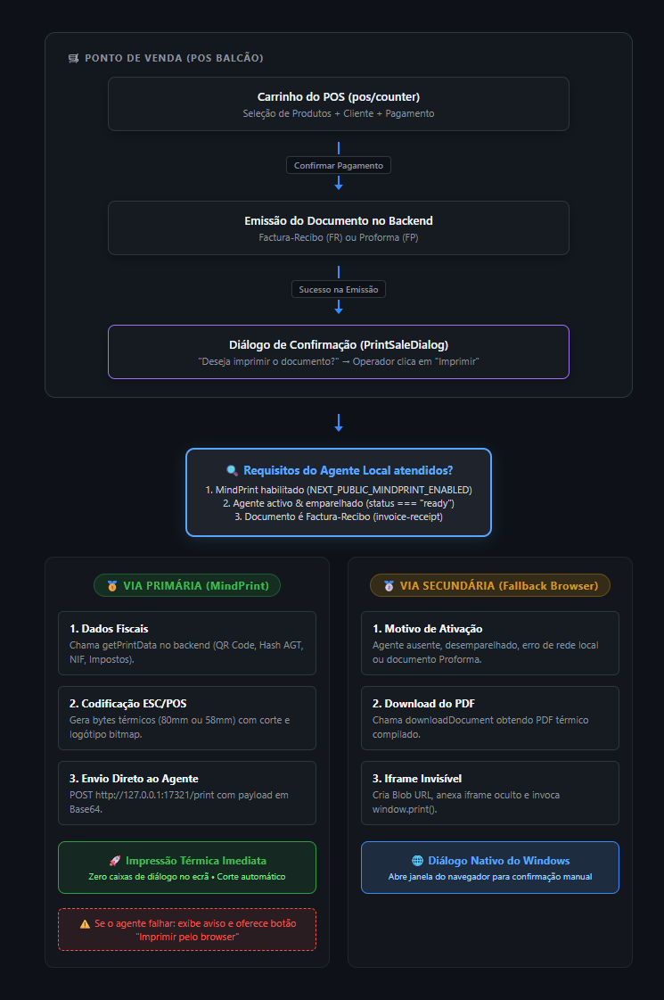
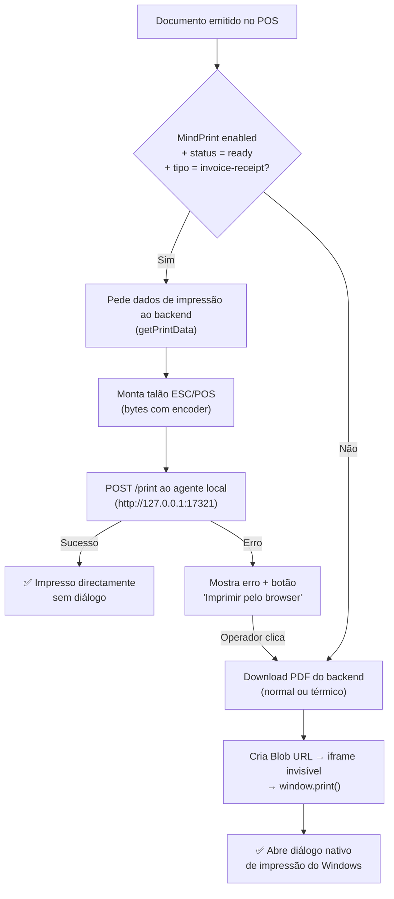
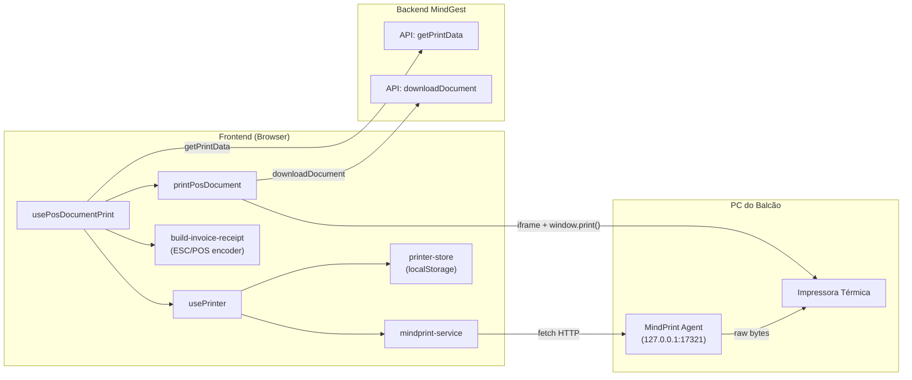
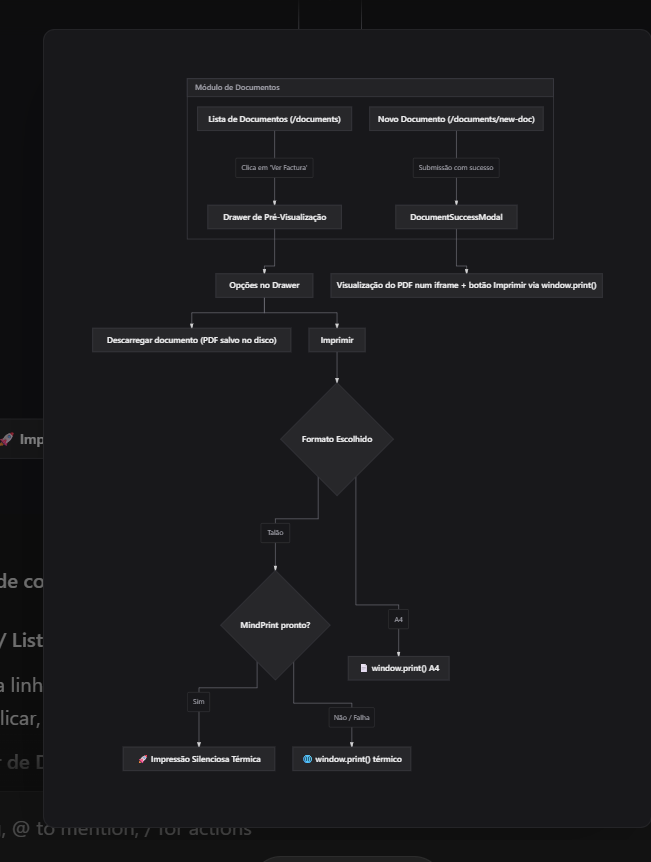

# 🖨️ Arquitectura de Impressão no POS

> Documentação interna — última actualização: Novembro 2026

## Visão Geral

O sistema de impressão do POS suporta **dois caminhos** para imprimir documentos, orquestrados pelo hook `usePosDocumentPrint`. O caminho preferido é o **MindPrint** (agente local ESC/POS); quando este não está disponível, o sistema recorre ao **browser** (`window.print()` via iframe).

---

## Fluxo de Decisão





---

## Caminho 1 — MindPrint (Agente Local ESC/POS)

> **Caminho preferido** para documentos do tipo `invoice-receipt` (Factura Recibo).

### Como funciona

1. O frontend verifica se o MindPrint está **ligado** (`NEXT_PUBLIC_MINDPRINT_ENABLED=true`), **emparelhado** e com status **ready**
2. Pede os dados estruturados do documento ao backend (`invoiceReceiptService.getPrintData`)
3. Monta o talão com **comandos ESC/POS** usando a lib `@point-of-sale/receipt-printer-encoder`
4. Envia os bytes codificados em **base64** ao agente local via `POST /print`
5. O agente despacha para a impressora — **sem abrir nenhum diálogo no browser**

### Componentes envolvidos

| Ficheiro | Responsabilidade |
|----------|-----------------|
| [`src/services/mindprint-service.ts`](../src/services/mindprint-service.ts) | Cliente HTTP do agente local (fetch directo a `127.0.0.1`) |
| [`src/hooks/pos/use-printer.ts`](../src/hooks/pos/use-printer.ts) | Estado e acções do agente (health, pair, print, printers) |
| [`src/hooks/pos/use-pos-document-print.ts`](../src/hooks/pos/use-pos-document-print.ts) | Orquestrador — decide MindPrint vs browser |
| [`src/stores/pos/printer-store.ts`](../src/stores/pos/printer-store.ts) | Preferências persistidas em localStorage (token, porta, impressora, largura do papel) |
| [`src/utils/receipt/build-invoice-receipt.ts`](../src/utils/receipt/build-invoice-receipt.ts) | Montagem do talão ESC/POS (layout, colunas, logótipo, QR) |
| [`src/utils/receipt/receipt-images.ts`](../src/utils/receipt/receipt-images.ts) | Processamento de imagens para o talão (logótipo, QR code) |
| [`src/utils/receipt/receipt-text.ts`](../src/utils/receipt/receipt-text.ts) | Utilitários de texto para colunas e word-wrap no talão |
| [`src/utils/receipt/validate-print-data.ts`](../src/utils/receipt/validate-print-data.ts) | Validação dos dados antes de montar o talão |
| [`src/constants/mindprint.ts`](../src/constants/mindprint.ts) | Constantes (porta, timeouts, colunas por largura de papel, códigos de erro) |
| [`src/types/mindprint.ts`](../src/types/mindprint.ts) | Tipos TypeScript (health, printers, print result, dados do talão) |
| [`src/schemas/mindprint-schema.ts`](../src/schemas/mindprint-schema.ts) | Schemas de validação |

### Emparelhamento

O MindPrint usa um sistema de **emparelhamento por código** (semelhante a Bluetooth):

1. O operador gera um código no ícone do MindPrint (tray do Windows)
2. Insere o código na UI do POS → `POST /pair` ao agente
3. O agente devolve um **token** que fica guardado em `localStorage`
4. Cada browser emparelha em separado (Chrome e Edge têm tokens diferentes)

### Larguras de papel suportadas

| Papel | Colunas (fonte A 12×24) | Largura máx. imagem |
|-------|-------------------------|---------------------|
| 80mm  | 48 colunas              | 384 px              |
| 58mm  | 32 colunas              | 320 px              |

### Endpoints do agente

| Método | Endpoint | Descrição |
|--------|----------|-----------|
| `GET`  | `/health` | Verifica se o agente está a correr e se está emparelhado |
| `POST` | `/pair` | Emparelha o browser com o agente (envia código, recebe token) |
| `GET`  | `/printers` | Lista as impressoras disponíveis (autenticado) |
| `POST` | `/print` | Envia bytes ESC/POS para impressão (autenticado) |
| `POST` | `/test-print` | Imprime página de teste (autenticado) |

### Tratamento de erros

| Código | Significado | Acção |
|--------|-------------|-------|
| `AGENT_UNAVAILABLE` | Agente não instalado, parado ou rede local bloqueada | Status → "unavailable" |
| `NOT_PAIRED` / `INVALID_TOKEN` | Token inválido ou expirado | Esquece token, pede novo emparelhamento |
| `PRINTER_NOT_FOUND` / `INVALID_PRINTER` | Impressora seleccionada já não existe | Pede nova selecção |
| `JOB_IN_PROGRESS` | Talão já está a imprimir | Mensagem informativa, sem erro |
| `INVALID_REQUEST` / `INVALID_DATA` | Bug do lado do MindGest | Log de erro para diagnóstico |

---

## Caminho 2 — Browser Fallback (PDF + `window.print()`)

> Usado quando o MindPrint está **desligado**, **indisponível**, **não emparelhado**, ou para tipos de documento que **não sejam** `invoice-receipt`.

### Como funciona

1. Faz download do **PDF** do backend via `downloadDocument(id, type, format)`
   - O formato pode ser `"pdf"` (A4) ou `"thermal"` (papel térmico), conforme a configuração `useThermalPrinter`
2. Cria um **Blob URL** (`URL.createObjectURL`)
3. Injeta um **iframe invisível** no DOM com o PDF como `src`
4. Após o iframe carregar (com delay de 350ms para o plugin de PDF do Chromium), chama `printWindow.print()`
5. Escuta o evento `afterprint` para fazer cleanup
6. Timeout de segurança de 30s caso o `afterprint` não dispare
7. Revoga o Blob URL após 60s (tempo para o spooler da impressora terminar)

### Componentes envolvidos

| Ficheiro | Responsabilidade |
|----------|-----------------|
| [`src/utils/print-pos-document.ts`](../src/utils/print-pos-document.ts) | Download do PDF, criação do iframe, chamada a `window.print()` |
| [`src/hooks/pos/use-pos-document-print.ts`](../src/hooks/pos/use-pos-document-print.ts) | Orquestrador (função `printInBrowser`) |

---

## Comparação dos Dois Caminhos

| | MindPrint (ESC/POS) | Browser (PDF) |
|---|---|---|
| **Método de impressão** | `fetch` → agente local → impressora | iframe + `window.print()` |
| **Formato do documento** | Bytes ESC/POS (raw) | PDF (A4 ou térmico) |
| **Diálogo de impressão** | ❌ Sem diálogo, impressão directa | ✅ Diálogo nativo do browser |
| **Tipos de documento** | Apenas `invoice-receipt` | Todos os tipos |
| **Requisitos** | MindPrint instalado e emparelhado | Nenhum |
| **Selecção de impressora** | Via settings do POS | Via diálogo do browser |
| **Experiência do operador** | Mais rápida (1 clique) | Mais lenta (diálogo + confirmar) |

---

## Configuração

### Variáveis de ambiente

| Variável | Descrição | Default |
|----------|-----------|---------|
| `NEXT_PUBLIC_MINDPRINT_ENABLED` | Activa o caminho MindPrint | `false` |

### LocalStorage (por browser)

Chave: `mindprint-settings`

```json
{
  "token": "string | null",
  "port": 17321,
  "printerId": "string | null",
  "paperWidth": "80mm"
}
```

---

## Diagrama de Componentes



---

## UI de Impressão (PrintSaleDialog)

Após a emissão do documento, o operador vê um diálogo com as seguintes opções:

- **"Imprimir"** → tenta o MindPrint se disponível, senão browser
- **"Imprimir pelo browser"** → aparece apenas quando o MindPrint falha (fallback explícito)
- **"Agora não"** → fecha sem imprimir

Ficheiro: [`src/components/client/pos/counter/cart/checkout-form/print-sale-dialog.tsx`](../src/components/client/pos/counter/cart/checkout-form/print-sale-dialog.tsx)

---

## Settings da Impressora no POS

A configuração da impressora (emparelhamento, selecção de impressora, largura do papel, teste de impressão) é feita na página de settings do POS:

Ficheiros: `src/components/client/pos/settings/contents/printer/`

---

## Impressão a partir do Módulo de Documentos



Nos detalhes/pré-visualização de qualquer documento (Drawer de visualização rápida da Factura, Recibo ou Nota de Crédito), o operador dispõe do componente [`PrintDocumentButton`](../src/components/client/documents/common/print-document-button.tsx) ao lado de "Descarregar documento":

1. **Formato A4**: Descarrega o PDF do backend e envia para `printDocumentDirectly()` acionando o diálogo nativo do sistema via `window.print()`.
2. **Talão (Térmica)**:
   - **Primário (MindPrint)**: Se o agente estiver ativo e o documento for suportado (`invoice-receipt`), obtém os dados estruturados de `getPrintData()`, gera os comandos ESC/POS e envia silenciosamente para a impressora de talões (sem diálogos de navegador).
   - **Fallback Secundário (Browser)**: Se o agente não responder ou der erro, o sistema ativa automaticamente a emissão do PDF térmico através de `window.print()`.


